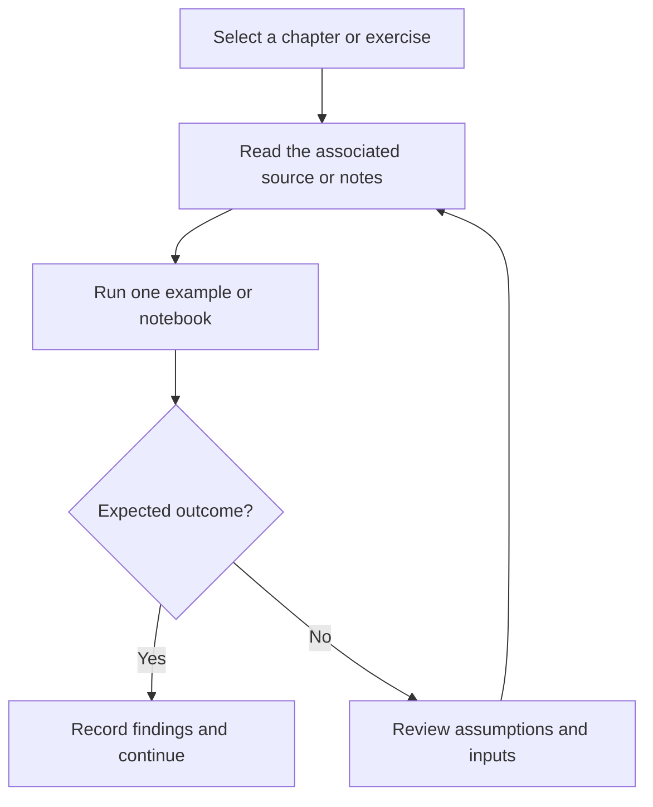

# Oracle Agentic AI Foundations — Study Guide

Agentic AI study guide with chapters on agents, LangChain, MCP, OpenAI APIs, and OCI enterprise concepts.

## Project focus

Learning notes and notebooks. Use the directory map to choose a focused example or learning topic instead of treating the repository as one application.

## Workflow



The diagram describes how to work through the material; it is not a deployed service topology.

## Repository structure

| Path | Purpose |
| --- | --- |
| [`Chapter 0 - Overview/`](Chapter%200%20-%20Overview) | Topic-organized learning material and examples. |
| [`Chapter 1 - Introduction to AI Agents/`](Chapter%201%20-%20Introduction%20to%20AI%20Agents) | Topic-organized learning material and examples. |
| [`Chapter 2 - LangChain for AI Agents/`](Chapter%202%20-%20LangChain%20for%20AI%20Agents) | Topic-organized learning material and examples. |
| [`Chapter 3 - Introduction to MCP/`](Chapter%203%20-%20Introduction%20to%20MCP) | Topic-organized learning material and examples. |
| [`Chapter 4 - Open AI Responses API and Agents SDK Basics/`](Chapter%204%20-%20Open%20AI%20Responses%20API%20and%20Agents%20SDK%20Basics) | Topic-organized learning material and examples. |
| [`Chapter 5 - Agentic AI for OCI Enterprise AI/`](Chapter%205%20-%20Agentic%20AI%20for%20OCI%20Enterprise%20AI) | Topic-organized learning material and examples. |
| [`LICENSE`](LICENSE) | Repository licensing terms. |

## Getting started

```bash
git clone https://github.com/Raimal-Raja/Oracle-Agentic-AI-Foundations-Associate.git
cd Oracle-Agentic-AI-Foundations-Associate
```

```bash
python -m venv .venv
source .venv/bin/activate
```

On Windows PowerShell, activate the environment with `.venv\Scripts\Activate.ps1` instead.

Open one `.ipynb` file in Jupyter, VS Code, Kaggle, or Colab. Read its dependency and dataset cells before execution. Notebook paths and model/data requirements vary; this repository is not one shared deployable application.

## Verification

Use the setup commands and inspect the selected interface, example, or notebook with known inputs. This documentation review checks repository paths and dependency declarations; it does not claim fresh end-to-end execution or model-quality measurements.

## Detailed project guide

Welcome to my learning repository for the **Oracle Agentic AI Foundations Associate (2026)** certification.

I created this repository to document my own learning journey and to provide a practical, structured resource for others who are preparing for the Oracle Agentic AI Foundations certification.

The goal is to make it easier for developers, AI/ML engineers, cloud developers, data scientists, and anyone interested in Agentic AI to learn the fundamental concepts, explore practical examples, and prepare for the certification exam.

## 🎯 My Mission

My mission is to **learn, build, document, and share**.

As I progress through the Oracle Agentic AI Foundations learning path, I will organize my notes, examples, code, exercises, and useful resources in this repository. My aim is to create an open learning resource that can help others understand Agentic AI concepts and prepare for the Oracle certification.

I believe that the best way to learn technology is not only to study it, but also to **build with it and share what you learn with others**.

## 📚 What You Will Learn

This repository is intended to complement the official Oracle learning path and may cover topics such as:

* Core concepts of Artificial Intelligence and Agentic AI
* AI agents and agent architectures
* Large Language Models (LLMs)
* LangChain
* OpenAI Agent Stack
* Model Context Protocol (MCP)
* Oracle Cloud Infrastructure (OCI)
* OCI Enterprise AI capabilities
* Building AI agents on Oracle Cloud
* Oracle AI Database capabilities for Agentic AI
* Practical examples and hands-on exercises
* Certification preparation and revision notes

## 🧑‍💻 Who Is This For?

This repository may be useful for:

* AI and ML engineers
* Software developers
* Cloud developers
* Data scientists
* Python developers
* Oracle Cloud learners
* Developers interested in Agentic AI
* Anyone preparing for the Oracle Agentic AI Foundations Associate certification

You don't need to be an expert in Agentic AI to get started. The learning path begins with the fundamentals, making it suitable for learners who are new to the field.

## 🛠️ Prerequisites

Before starting, it is helpful to have:

* Basic familiarity with LLM concepts
* Functional knowledge of Python
* Basic familiarity with Oracle Cloud Infrastructure (OCI)

## 🚀 Skills You Can Develop

By completing the learning journey, you can build an understanding of how to:

* Explain fundamental AI agent concepts
* Understand how agentic AI systems work
* Design AI agents using modern agent frameworks
* Explore LangChain and the OpenAI Agent Stack
* Understand Model Context Protocol (MCP) concepts
* Build AI agents using Oracle Cloud Infrastructure
* Explore OCI Enterprise AI capabilities
* Apply Oracle AI Database capabilities to Agentic AI use cases

## 📝 Certification Preparation

The official Oracle learning path includes resources to help prepare for the certification exam, including:

1. Oracle Cloud Infrastructure Agentic AI Foundations course
2. Course lessons
3. Skill checks
4. Certification preparation content
5. Practice exam
6. Official certification exam

This GitHub repository is intended to serve as a **community learning resource and personal study companion**. It does not replace the official Oracle training materials or certification requirements.

For the official certification requirements, exam registration, and credential information, always refer to Oracle's official resources.

## 🌟 Why I Created This Repository

Agentic AI is rapidly evolving, and I want to learn by building practical projects, documenting my understanding, and sharing knowledge with the developer community.

My goal is simple:

> **Learn Agentic AI. Build real solutions. Document the journey. Help others learn.**

If this repository helps you understand a concept, build your first AI agent, or prepare for your certification journey, then it has achieved its purpose.

## 🤝 Contributions

If you find an error, have a suggestion, or want to improve the learning resources, contributions and discussions are welcome.

Let's learn and build together. 🚀

**Happy Learning and Good Luck with Your Certification Journey!**

## Contributing

Include reproduction steps, the affected path, expected behavior, and the checks you ran. Keep credentials, generated environments, and unnecessary build artifacts out of commits.

## License

See [LICENSE](LICENSE) for the repository's license.
